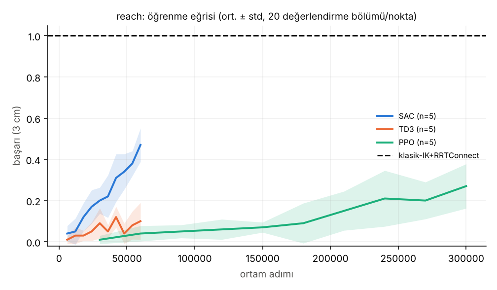
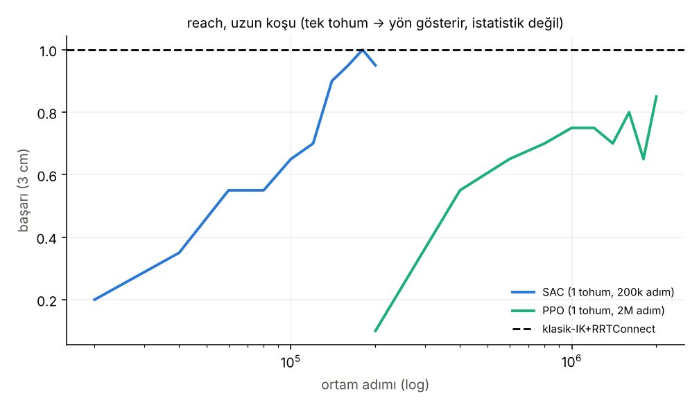

# RL karar belgesi — 6 eksenli kol (MuJoCo, ROS'suz)

Tarih: 2026-11-02 · Hazırlayan: otomatik araştırma oturumu (Ferhat uyurken çalıştı) · Kapsam: yalnızca `research/rl/`

## 0. Tek paragraf özet

Bu robot için, burada kurduğumuz üç görevde (reach, engelli reach, hareketli hedef takibi) **klasik yöntemler (DLS-IK, IK+RRT-Connect) RL'den belirgin biçimde iyi çıktı**; bu beklenen bir sonuç ve hata değil. En iyi RL (SAC) reach görevinde 60k adımda %49 başarıya ulaştı (5 tohum), tek tohumlu uzun koşuda 200k adımda %94'e çıktı; klasik IK 0 eğitimle %100. Engelli reach ve takipte bütçemiz (80k–400k adım) RL için yetersiz kaldı: "RL bu görevde işe yaramaz" **demiyoruz**, "bu bütçede klasiğe yaklaşamadı" diyoruz. Bu deneylerden RL'nin hangi görevde değer kattığı **henüz gösterilemedi**; bunun için görev tipi değişmeli (bkz. §6). Sim-to-real tarafında en büyük risk RL algoritması değil, motor/gecikme/aktüatör modeli ve güvenlik; yol haritası §5'te.

## 1. Ne kurduk

- `urdf_to_mjcf.py`: `robot.urdf` → MJCF; limit/eksen/kütle/atalet/FK URDF ile birebir doğrulandı (`scripts/test_consistency.py`, FK farkı 5e-16 m).
- Ortamlar (`rl_arm/envs.py`): `reach` (hedef 3 cm içinde, bölüm 100 adım=5 s), `obstacle` (7 cm küre engel başlangıç–hedef doğrusunun yakınında; çarpışmasız başarı), `track` (eklem uzayında sinüsle hareket eden hedef, 10 s).
- Eylem: eklem konum komutu artışı (≤ URDF hız limiti 1 rad/s), 20 Hz. Aktüatör: konum servo (kp=500), %95 yerçekimi telafisi.
- Klasik taban: DLS hız kontrolü (+ hareketli hedefte ileri besleme) ve IK + RRT-Connect + kısayol yumuşatma (MoveIt/OMPL'nin yaptığına benzer, ama MoveIt'in kendisi değil).
- RL: SB3 2.9 — PPO (8 ortam), SAC, TD3; hepsi 2×128 MLP, CPU, tohumlar 0–4, hiperparametre **ayarı yapılmadı** (bkz. §4).
- Dayanıklılık (DR) testi: kütle ±%30, kp ±%40, sönümleme −%50…+%100, eylem gecikmesi 0–2 adım (0–100 ms), gözlem gürültüsü; politikalar **nominal modelde eğitilip** DR altında değerlendirildi (DR ile eğitilmiş politika denenmedi).

## 2. Sonuçlar (5 tohum, ortalama ± std; değerlendirme: 100 sabit bölüm × tohum)

Birincil metrik: reach = başarı, engel = çarpışmasız başarı, takip = kuyruk başarısı (bölümün ikinci yarısında hedefe <5 cm olma oranı). Ayrıntı: `results/summary.md`, grafikler `results/*.png`.

| görev | SAC | TD3 | PPO | klasik (en iyisi) |
|---|---|---|---|---|
| reach (60k/60k/300k adım) | **0.49 ± 0.11** | 0.15 ± 0.03 | 0.29 ± 0.10 | **1.00** (IK+RRT) · DLS-hız 0.83 |
| engel (80k/80k/400k adım) | 0.09 ± 0.04 | 0.01 ± 0.01 | 0.33 ± 0.10 | **1.00** (IK+RRT) · DLS-hız 0.46 |
| takip (80k/80k/400k adım) | 0.08 ± 0.03 | 0.01 ± 0.01 | 0.03 ± 0.02 | **0.90** (DLS-hız, ort. hata 8.4 cm) |



Okuma kılavuzu:

1. **Klasik ≫ RL, her üç görevde, bu bütçelerde.** Fark tohum gürültüsünün çok üstünde; tartışmaya gerek yok.
2. **RL algoritmaları arasında (eşit ortam-adımında) SAC en örnek-verimli.** Reach'te SAC–TD3 (p=0.002) ve SAC–PPO (p=0.018) farkı anlamlı. TD3–PPO reach'te Mann-Whitney'e göre **anlamlı değil** (p=0.075); takipte de TD3–PPO **anlamlı değil** (p=0.10). Engel görevinde tablodaki "PPO > SAC" **yanıltıcı**: PPO'ya 5× fazla adım verildi; eşit adımda (80k) PPO 0.02, SAC 0.09 (`summary.md`, "eşit adımda eğri" sütunu).
3. **Duvar saati:** PPO ucuz (reach 300k adım ≈ 2.4 dk), SAC pahalı (60k adım ≈ 12 dk; 2 CPU'da gradyan adımı darboğaz). Örnek-verimlilik ile saat verimliliği ters yönde. GPU'lu çok-ortamlı kurulumda (MJX) PPO'nun avantajı daha da büyür.
4. **Uzun koşu (reach, tek tohum — yön gösterir, kanıt değil):** SAC 200k adımda %94 (43 dk), PPO 2M adımda %75 (15 dk). Yani RL öğreniyor, ama IK'nın bir anda yaptığı işe 10⁵–10⁶ adım harcıyor.

   

5. **DR dayanıklılığı:** klasik IK+RRT DR=1'de %99–100'ü korudu (ama ayrıcalıklı bilgi kullanıyor: gürültüsüz FK, engel konumu). RL politikaları DR=1'de nominalden **kötüleşmedi, hatta çoğu yerde arttı** (örn. engel/SAC 0.09 → 0.21). Bunu **açıklayamıyoruz**; olası nedenler: DR'deki gecikme/kp azalması hareketi yavaşlatıp çarpışmayı azaltıyor, ya da politikalar zaten düşük kalitede ve sıçrama gürültüsü yardım ediyor. "RL DR'ye dayanıklı" sonucu çıkarmıyoruz; bu, ancak iyi eğitilmiş politikalarla anlamlı olur.
6. Takip görevinde hiçbir RL ajanı anlamlı öğrenemedi (en iyi SAC ort. hata 17 cm, klasik 8 cm). Bu sonuçtan "RL takip yapamaz" çıkmaz; bütçe/ödül/gözlem tasarımı yetersiz olabilir.

## 3. RL hangi görevde değer katar? (dürüst cevap)

Bu deneyde **hiçbirinde kanıtlayamadık**. Reach'te klasik IK optimal ve bedava; engelli reach'te IK+RRT çözüyor (bu basit sahnede bölüm başına ~20 ms duvar saati); takipte çözüm zaten kapalı çevrim. RL'nin beklenen değeri **klasik formülasyonun zorlaştığı** yerlerde: temas ve kavrama (pick-and-place, sürtünme/şekil belirsizliği), dinamik/öngörülemez engeller (planlayıcı her adımda yeniden planlamalı), görüntü girdisinden doğrudan eylem, modellenemeyen dinamik (esnek kablo, servo boşluğu) altında düzeltici (residual) politika. Bu görevleri henüz ortama koymadık; bu bir sonraki adımdır (§6). Kaynaklar da bu çerçeveyi destekliyor: reach-avoid kıyas çalışması (arXiv 2607.15935) PPO'yu UR5e'de %96 reach başarısına getirmiş ama bunu klasik bir planlayıcıyla karşılaştırmamış, yalnızca RL'nin kendi içinde kıyas yapmış; yani "RL kıyas görevleri çözer" ≠ "RL klasikten iyi".

## 4. Dürüst sınırlar (sonuçlara güveni azaltan her şey)

- **Hiperparametre ayarı yok.** TD3'ün kötü sonucu algoritmanın doğası değil, bizim ayarsız varsayılanlarımız (gürültü 0.1, 2×128 ağ, lr 1e-3) olabilir. PPO için 2 hızlı pilot (lr 5e-4 / 1e-3) farksızdı, tam tarama yapılmadı.
- **Bütçe kısa.** 5 tohum, 60k–400k adım; engel/takip eğrileri bu bütçede yakınsamadı. Kısa koşulardan "RL bu görevde yetersiz" çıkarmıyoruz.
- Tek tohumlu uzun koşular istatistik değildir.
- Klasik taban env içinden **ayrıcalıklı** bilgi kullanıyor (gürültüsüz FK, engel konumu); RL yalnızca gözlemi görüyor (gözlemde engel konumu var ama gürültü DR'de ekleniyor). Gerçek robotta klasik de algılamaya muhtaç.
- Engel görevi dar: tek küre; açık çevrim IK+RRT bunu çözüyor. Dinamik engel, çoklu engel yok.
- Kütle/atalet URDF'teki **yer tutucu** değerler; aktüatör (kp, kv, %95 yerçekimi telafisi) gerçek servoyu temsil etmiyor — kendi seçimimiz.
- DR'li *eğitim* denenmedi; DR bulgusu açıklanamadı (§2.5).
- Sim2sim (Gazebo / Robot API v1) yapılmadı: opsiyoneldi, API v1'in yayınlandığı doğrulanmadı ve ROS'a dokunmama kuralı vardı.
- Kıyaslarda hata çubukları 5 tohum std'si; küçük örneklemde p-değerleri kaba. "Anlamlı değil" denen yerlerde gerçek bir fark olabilir (güç düşük).

## 5. Araştırma: simülatör/çerçeve, sim-to-real, yol haritası

Kaynakların tarihleri belirtilmiştir; tarihli iddialar sayfadan doğrulandı, doğrulanamayanlar belirtildi.

### 5.1 Simülatör/çerçeve (Ferhat'ın durumu: küçük 6 eksen, GPU'suz/zayıf dizüstü + WSL/PowerShell, tek kişi)

- **MuJoCo (CPU) + Gymnasium + SB3 — şimdilik en uygun.** Kurulumu tek `pip`, küçük kol için ~5–6 bin adım/sn/çekirdek (bu repoda ölçüldü), hata ayıklaması kolay. Zayıf nokta: büyük paralellik yok (yukarıdaki SAC 200k adım = 43 dk).
- **MuJoCo Playground / MJX (JAX, GPU):** MJX tabanlı, tek GPU'da "dakikalar içinde" politika eğitimi iddiası; Franka kolu ve Aloha içeriyor, gerçek robota sıfır-atış aktarım gösterilmiş (arXiv 2502.08844, Şubat 2025; [html](https://arxiv.org/html/2502.08844v1)). **NVIDIA GPU yoksa anlamlı değil.** Aynı çalışmanın ikinci tarafı: reach-avoid kıyası (arXiv 2607.15935, tarihi sayfada belirtilmemiş) MJX+Brax ile SB3'e göre >10× hızlanma bildiriyor.
- **MuJoCo Warp (MJWarp):** NVIDIA+DeepMind; NVIDIA donanımına özel, **beta**, tüm özellikler yok, türevlenemez ([dokümantasyon 3.5.0](https://mujoco.readthedocs.io/en/3.5.0/mjwarp/index.html)); Playground'a 28 Ağustos 2025'te beta olarak girdi, birçok manipülasyon ortamında "1.5–2× daha yüksek verim" bildirildi ([duyuru](https://github.com/google-deepmind/mujoco_playground/discussions/197)). Küçük bir kol için gereksiz karmaşıklık.
- **Isaac Lab:** 3.0 hâlâ **beta** (belge damgası 31 Ekim 2026; kararlı sürüm "1–2 ay" içinde bekleniyor denmiş); Isaac Sim 6.0, Python 3.12, PyTorch 2.10, RTX GPU gerektirir; Newton (MuJoCo-Warp tabanlı) arka ucu ve Kit'siz mod var; Windows pip kurulumu beta2'de belgelenmiş ([sürüm notları](https://isaac-sim.github.io/IsaacLab/v3.0.0/source/refs/release_notes.html)). Tek kişilik, tek kollu proje için ağır; ancak Isaac Sim'in kamera/algı özellikleri gerekirse düşünülür.
- **Genesis:** Apache-2.0; URDF/MJCF alır; Linux/Windows'ta CPU-only kurulum seçeneği var; "Genesis World 1.0" için Mayıs 2026 tarihi bir alıntıda geçiyor ama sürüm sayfasında doğrulanamadı; kararlılık beyanı yok ([repo](https://github.com/Genesis-Embodied-AI/genesis-world)). İzlemeye değer, şimdilik ana aday değil.
- **Öneri:** MuJoCo CPU + SB3 ile devam; NVIDIA GPU'lu bir makine (veya bulut GPU) bulunursa MJX/Playground'a geçiş **yalnızca PPO ile milyon-adım deneyleri yavaşlamaya başladığında**. Isaac Lab/Genesis'e şimdilik geçme.

### 5.2 Algoritma seçimi (bu deneyden + kaynaklardan)

- CPU/az-ortam rejiminde **SAC** (örnek-verimli); bizim ölçümümüzde eşit adımda en iyi. GPU/çok-ortam rejiminde **PPO** (arXiv 2607.15935'te UR5e reach'te PPO %96, SAC %61.6 — ancak bu kıyas dev paralellikte ve ince ayarlı; bizim CPU sonucumuzla çelişmez, rejim farklı).
- TD3'ü ayarsız bıraktık; bir kez ayar yapılmadan "TD3 kötü" demeyin.
- Pratik reçete: klasik IK/planlayıcı **temel**, RL yalnızca **düzeltme (residual)** ya da klasiğin zorlandığı alt görev için.

### 5.3 Sim-to-real riskleri

- **Bilgi/yetki farkı:** simülasyonda tam durum, anlık temas, deterministik zamanlama; gerçekte gecikmeli, kısmi gözlem ve doyan aktüatörler (MDP → POMDP) ([appscale blog, 2026](https://appscale.blog/en/blog/sim-to-real-transfer-robotics-reality-gap-domain-randomization-2026) ve [pracsyslab özeti](https://www.pracsyslab.org/autonomous-systems/survey-sim-to-real-transfer-reinforcement-learning/)).
- **Dinamik uyumsuzluğu:** sürtünme, boşluk (backlash), esneklik, enkoder nicemlemesi, ısıl sınırlama. Sistem tanılama + hedefli DR; "yalnızca DR yetmez" ([aynı kaynaklar](https://www.pracsyslab.org/autonomous-systems/survey-sim-to-real-transfer-reinforcement-learning/); ayrıca derleme: [arXiv 2009.13303](https://arxiv.org/abs/2009.13303), sistem tanılama / DR / alan uyarlaması üçlüsünü anlatıyor).
- **Motor ve kontrol gecikmesi:** faz kayması → titreşim/aşım. Yayımlanmadan önce politikayı 0–40 ms gözlem gecikmesi ve 1–2 adım eylem tutma ile stres testinden geçir (appscale, 2026). Bizim DR testinde gecikme 0–100 ms'ydi ve klasik politikalar bunu geçti; RL politikaları nominalde bile zayıf olduğundan RL için bu sonuç anlamlı değil.
- **Güvenlik:** yazılım eklem limitleri, akım/sıcaklık kilitleri, bağımsız acil durdurma, çalışma alanı, bağlama/destek; adım adım geçit (motorsuz gölge → bağlı düşük güç → insan kontrollü tam güç) (appscale, 2026).
- **Bu repoya özgü:** simülasyondaki ideal konum aktüatörü + %95 yerçekimi telafisi gerçek servoyu temsil etmez; gerçekte ilk iş aktüatör modelini (gecikme, kp/kv, tork sınırı, ısı) gerçek verilerle uydurmak.

### 5.4 Gerçek robota yol haritası (küçük 6 eksen)

Hedef donanım için somut örnek: SO-ARM101 (6 eksen, STS3215 veri yolu servoları, 12-bit manyetik enkoder, LeRobot desteği, 220–240 USD + yaklaşık 35 USD baskı; [CNX Software, 2 Mayıs 2025](https://www.cnx-software.com/?p=149841) — fiyat o tarihe aittir, güncelliğini doğrula). Kendi 6 eksenli tasarımınız için de aynı adımlar geçerli:

1. **Aktüatör tanılaması (sim'i gerçeğe çekmek):** servo adım yanıtı, gecikme, hız/tork sınırı ölçümü → MJCF'te kp/kv/armature/gecikme güncelle. RL'den *önce*.
2. **Klasik taban gerçekte:** DLS hız kontrolü + IK'yı gerçek kolda çalıştır (hiç RL yok). Başarı ölçütü bu repodaki 3 görev.
3. **Sim'de zorlaştırılmış görev:** temas içeren görev (basit it/uzat), DR'li eğitim, gecikme DR'si gerçek ölçüme göre.
4. **Sim2sim:** politikayı Gazebo'da/başka bir simülatörde (Robot API v1 yayınlanınca) değerlendir.
5. **Gerçek: gölge mod → bağlı düşük hız → serbest.** İlk koşuda eylemi klasik denetleyiciyle sınırla (hız/menzil kırpma, RL yalnızca küçük düzeltme).
6. **Gerçek veriyle ince ayar / sistem tanılama döngüsü**, ancak güvenlik geçitleri sağlanınca.

## 6. Sıradaki adımlar (öncelik sırasıyla)

1. **RL'nin kazanabileceği bir görev ekle:** dinamik engel (hareketli küre; planlayıcı her adımda yeniden planlama zorunda) ve/veya basit temas görevi (nesneyi it). Hipotez: klasik IK+RRT bunda zayıflar; RL'nin reaktif politikası avantaj sağlayabilir. Bu hipotez **test edilmedi**.
2. **Residual RL:** klasik IK/DLS çıktısının üzerine küçük bir düzeltme öğren (örnek-verimliliği ciddi artması beklenir; test edilmedi).
3. **Ayar + bütçe:** SAC ve TD3'e sınırlı hiperparametre taraması, engel/takip için ≥200k adım, tohum sayısı 5'te kal.
4. **DR'li eğitim ve açıklanamayan DR bulgusunun ayıklanması** (gecikmeyi tek başına aç/kapa deneyi).
5. Aktüatör modelini gerçek servo verisine uydur (donanım gelince).
6. NVIDIA GPU erişimi olursa aynı ortamları MJX/Playground'a taşı (PPO ile milyon-adım koşular).

## 7. Tekrar üretme

```bash
cd research/rl && pip install -r requirements.txt
python scripts/test_consistency.py && python scripts/test_envs.py
python scripts/eval_baselines.py 100        # ~birkaç dk
bash scripts/run_all.sh                      # 45 koşu, 2 çekirdekte ~3.7 saat  (SAC reach 12 dk, engel/takip 17 dk; PPO 2-3.5 dk; TD3 7-10 dk)
python scripts/aggregate.py                  # results/summary.md + PNG'ler
python scripts/train.py --algo sac --task reach --seed 0 --steps 200000 --out runs_long   # uzun koşu (43 dk)
```

Ham sonuçlar: `results/runs/*.json` (45 koşu), `results/long/*.json`, `results/baselines.json`. Model dosyaları (`runs/`, `*.zip`) depoya eklenmedi.
